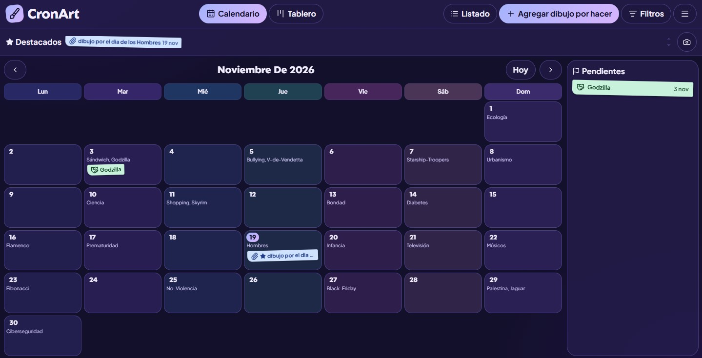
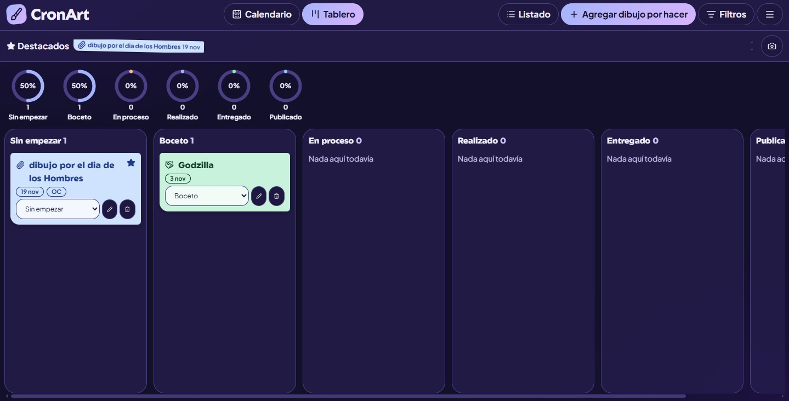

<div align="center">

# 🎨 CronArt

**El planificador visual para ilustradores.**  
Calendario con post-its, tablero de producción arrastrable, listado por lote y efemérides, todo en tu navegador y sin cuentas.  

[](#-instalar-como-app)[](#-tecnologías)[](#-tecnologías)[](#-características)[](https://ko-fi.com/naidi_art)
<br />

| 📅 Vista de Calendario | 🗂️ Tablero de Producción |
| :---: | :---: |
|  |  |

</div>

---

## ✨ Características

| | |
|---|---|
| 📅 **Calendario mensual** | Cada dibujo es un *post-it* en su día, con el color y el icono de su tipo, y columnas codificadas por color. Las efemérides se muestran solas.   |
| 🗂️ **Tablero Kanban** | Columnas por estado con **arrastrar y soltar (Drag & Drop)** validado según el tipo de dibujo, anillos de avance y cambio rápido de estado.   |
| 📋 **Listado general y por lote** | Vista de tabla buscable con todos tus dibujos para editar rápido o seleccionar y borrar varios a la vez.   |
| 📌 **Pendientes** | Columna lateral con las comisiones y collabs que aún no se entregan.   |
| ⭐ **Destacados** | Barra superior con tus notas favoritas. Límite global de **5**.   |
| 🔎 **Filtros y buscador** | Filtra por tipo y estado, o busca por título y notas.   |
| 🌗 **Tema claro y oscuro** | Interfaz con *glassmorphism*, paleta fría de alto contraste y animaciones suaves (respeta *reducir movimiento*).   |
| 🌐 **Español / English** | Cambio de idioma al instante en toda la interfaz.   |
| 👤 **Perfil de artista** | Nombre y redes (X, Instagram, Facebook, TikTok, Pinterest) con accesos directos siempre visibles.   |
| 💾 **Respaldo JSON** | Exporta e importa todos tus datos.   |
| 📲 **PWA** | Instalable y 100% funcional sin conexión tras la primera visita.   |

### Tipos de dibujo y estados

| Tipo | Icono | Estados |
|---|:--:|---|
| Efeméride / Dibujo libre | 📎 / ✏️ | Sin empezar → Boceto → En proceso → Realizado → Publicado   |
| Comisión | 💼 | Sin empezar → Boceto → En proceso → Realizado → Entregado → Publicado   |
| Collab | 🤝 | Sin empezar → Boceto → En proceso → Realizado → Entregado   |
| Collab (si eres el dueño) | 🤝 | Los anteriores + **En espera de otros**   |

Cada dibujo guarda: título, fecha, tipo, estado, estrella, casilla de OC, hasta 3 enlaces de referencia o una imagen local, y un caption o notas.  

---

## 🚀 Cómo usarlo

Entra al enlace del proyecto y empieza a usarla, sin instalar ni crear cuenta:  

<div align="center">

### 👉 [**https://elfaoscura.github.io/CronArt/**](https://elfaoscura.github.io/CronArt/)  

</div>

### Primeros pasos

1. Al abrir por primera vez, escribe tu **nombre de artista** y tus usuarios de redes.  
2. Pulsa **＋** o haz clic en cualquier día del calendario para añadir un dibujo.  
3. Si el día es una efeméride, la casilla viene marcada y el título se rellena solo.  
4. Cambia entre **Calendario** y **Tablero** (arrastra tarjetas entre columnas) o abre **Listado** para gestionar tus dibujos por lote.  
5. Abre el menú **☰** para perfil, tema, idioma, respaldo e instalación.  

### 📲 Instalar como app

En Chrome o Edge aparece **Instalar app** en el menú ☰ (o el icono de instalación en la barra de direcciones). En iOS usa **Compartir → Añadir a pantalla de inicio**.  

---

## 💾 ¿Dónde se guardan mis datos?

**Solo en tu dispositivo.** CronArt no tiene servidor ni cuentas: todo vive en el `localStorage` de tu navegador bajo la clave `cronart:v1`.  

```jsonc
{
  "profile": { "name": "…", "social": { "x": "usuario", "ig": "usuario" } },
  "items":   [ { "id": "…", "date": "2026-11-05", "title": "…", "type": "free",
                 "status": "todo", "star": false, "owner": false, "oc": false,
                 "refs": [], "caption": "", "img": "" } ],
  "lang": "es",
  "theme": "light"
}
```  

> 💡 **Consejo:** Haz respaldos en JSON desde el menú **☰** periódicamente o antes de borrar datos del navegador o cambiar de equipo.

---

## 🛠️ Tecnologías

* **Vite:** entorno de desarrollo y empaquetado.  
* **Tailwind CSS v4:** estilos, diseño adaptable y efectos *glassmorphism*.  
* **JavaScript:** lógica de calendario, tablero *Drag & Drop*, filtros, respaldo e internacionalización.
* **PWA (`manifest.json` + Service Worker):** instalación como aplicación y funcionamiento sin conexión.  

---

## 📁 Sistema de archivos

| Archivo / Carpeta | Para qué sirve |
| --- | --- |
| `css/` | Hojas de estilo del proyecto |
| `public/` | Recursos estáticos (`screen-calendario.jpg`, `screen-tablero.jpg`, iconos y vistas previas) |
| `src/` | Código fuente de la aplicación (calendario, tablero Kanban, listado, lógica y datos) |
| `.gitignore` | Archivos y carpetas excluidos del control de versiones |
| `README.md` | Documentación principal del repositorio |
| `index.html` | Plantilla HTML base de la aplicación |
| `package-lock.json` | Registro exacto del árbol de dependencias instaladas |
| `package.json` | Dependencias y scripts de Vite (`dev`, `build`, `preview`) |
| `tailwind.config.js` | Configuración de Tailwind CSS |
| `vite.config.js` | Configuración de Vite y del despliegue |

---

## ☕ Apoya el proyecto

CronArt es gratis y funciona en tu navegador. Si te resulta útil y quieres apoyar el desarrollo, puedes invitarme un café en [Ko-fi](https://ko-fi.com/naidi_art)  .

---

<div align="center">

*Hecho con 🎨 por [ElfaOscura](https://github.com/ElfaOscura).*

</div>
